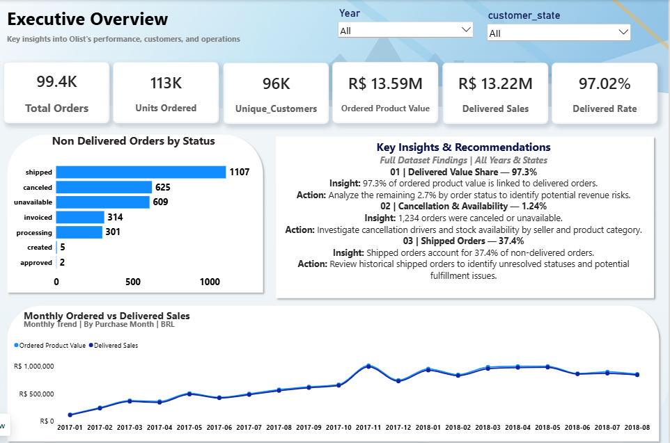
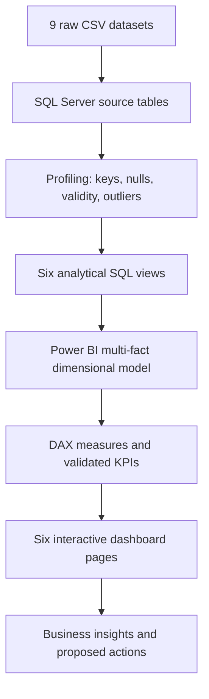
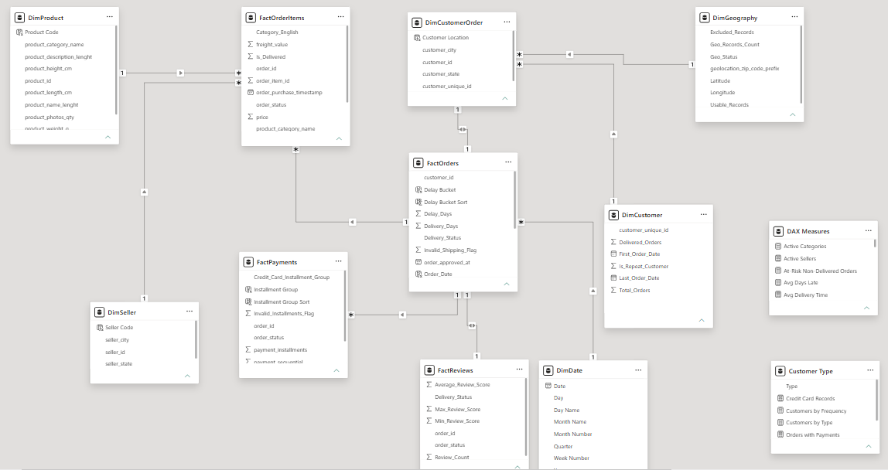
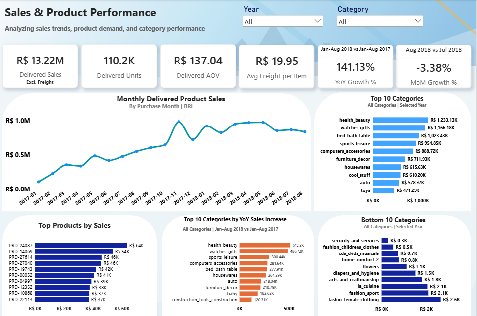
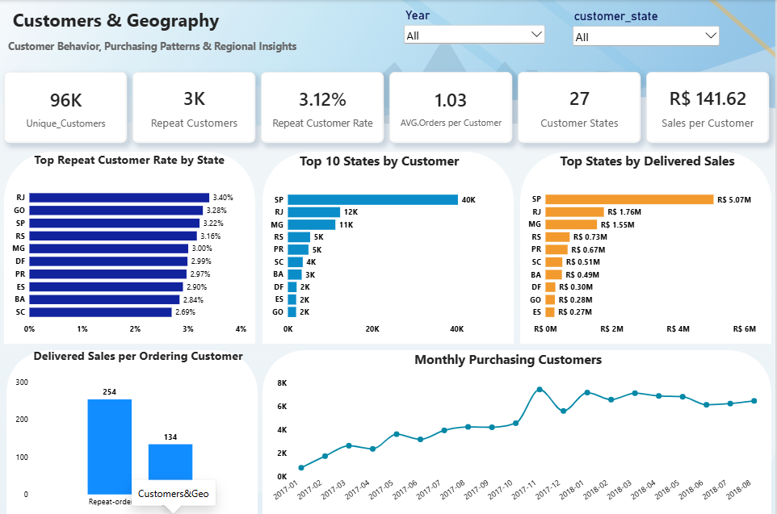
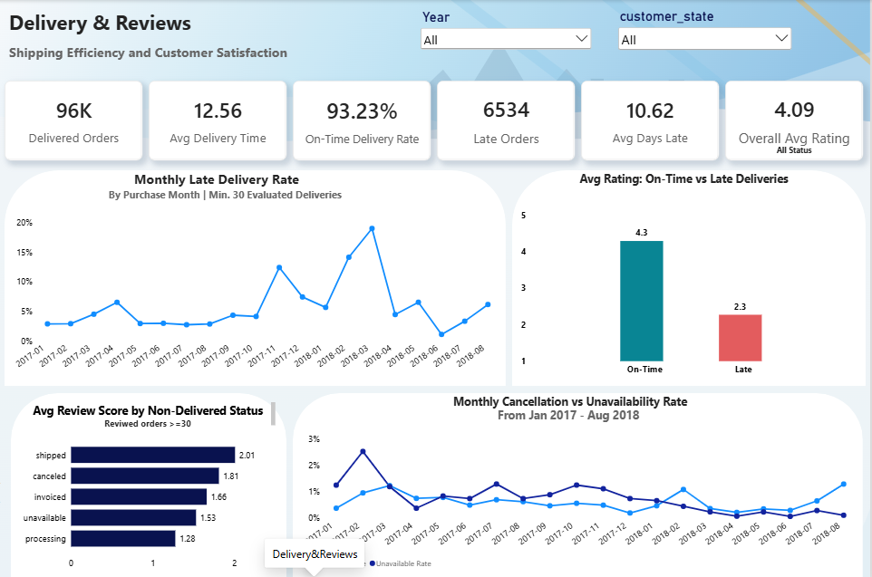
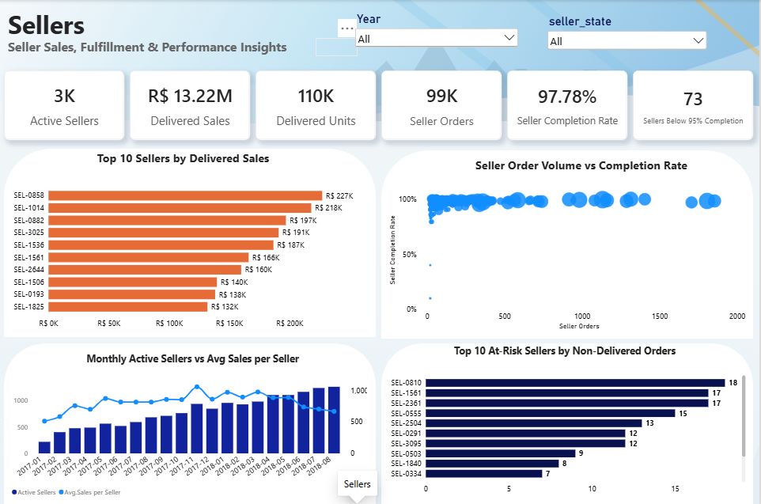
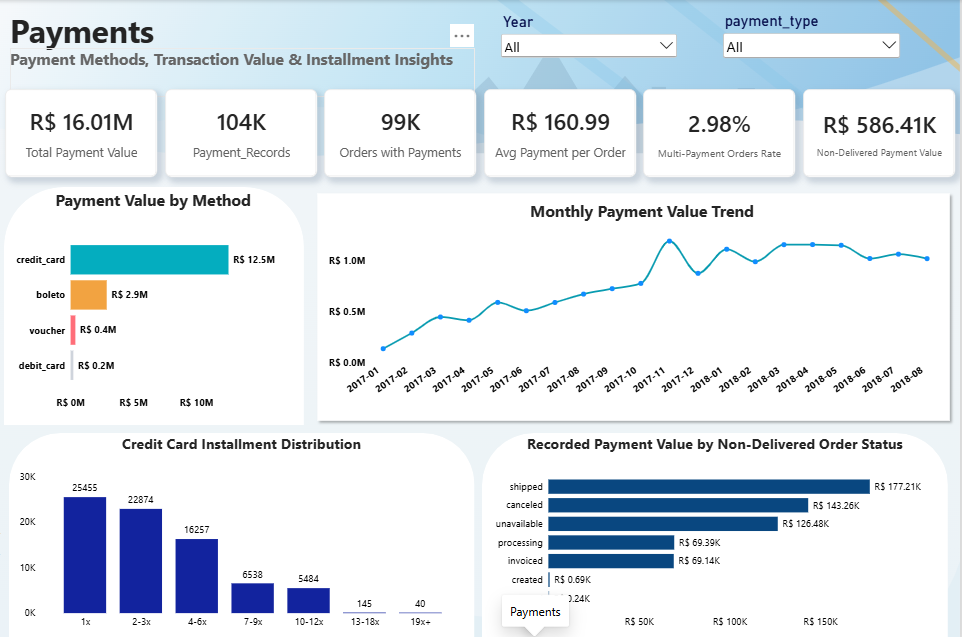

# E-Commerce Sales & Operations Analytics

### End-to-End SQL Server & Power BI Case Study — Brazilian Olist Dataset

**Author:** Menna Ahmed Amer  
**Contact:** Through the GitHub Issues tab of this repository  
**Tools:** Microsoft SQL Server · T-SQL · Data Profiling · ETL / Data Validation · SQL Views · Power BI · Dimensional Modeling · DAX · Business Intelligence  
**Domain:** E-commerce · Sales · Customer Behavior · Delivery & Reviews · Seller Operations · Payments

> An independent portfolio analysis of the [Brazilian E-Commerce Public Dataset by Olist](https://www.kaggle.com/datasets/olistbr/brazilian-ecommerce), not an official Olist company report.

## At a glance

| Total Orders | Delivered Rate | Delivered Product Sales | Unique Customers | On-Time Delivery | Power BI Pages |
|---:|---:|---:|---:|---:|---:|
| **99,441** | **97.02%** | **R$13.22M** | **96,096** | **93.23%** | **6** |

*Figures reflect the final Power BI dashboard's unfiltered scope. R$ is Brazilian real. Delivered product sales exclude freight. On-time delivery uses eligible delivered orders with valid dates.*

### Key findings

- **Delivery experience:** Late deliveries averaged **2.27/5** in customer reviews versus **4.29/5** for on-time deliveries (an association, not proof of causation).
- **Customer behavior:** Just **3.12%** of unique customers placed multiple orders within the observed period, using the **all-order-status** definition.
- **Payment exposure:** **R$586.41K** of recorded payment value is associated with non-delivered orders; refund and settlement records are required before treating this as a loss.

**Sections:** [Business problem](#2-business-problem) · [Architecture](#6-project-architecture) · [SQL](#8-sql-profiling-transformations-and-business-analysis) · [Data model](#9-power-bi-data-modeling) · [Dashboards](#11-dashboard-gallery) · [Insights](#12-key-insights--business-recommendations) · [How to run](#14-repository-structure--reproducibility)

**Deliverables:** [Power BI report](powerbi/Olist_Ecommerce_Analysis.pbix) · [Business Insights PDF](reports/Business_Insights_and_Recommendations.pdf) · [Defense Deck PDF](reports/Olist_Project_Defense_Deck.pdf) · [Dashboard Gallery PDF](reports/Dashboard_Screenshot_Gallery.pdf)



## 1. Project overview

This project takes nine relational Olist e-commerce datasets covering historical orders in Brazil and builds a SQL Server → Power BI analytical workflow. It profiles and validates source records, creates six reusable T-SQL views, builds a multi-fact dimensional model, defines DAX KPIs, and presents six dashboard pages to support commercial and operational decisions.

The goal is **not merely to visualize transactions**: it is to compute consistent, defensible metrics while avoiding wrong totals from different table grains.

## 2. Business problem

Marketplace data is distributed across order, item, seller, customer, payment, location and review tables. A simple join can distort counts and monetary values, while inconsistent eligibility rules can cause conflicting delivery and seller performance metrics.

The business questions are:

1. **Sales:** What merchandise value is associated with completed deliveries, and which categories/geographies drive it?
2. **Customers:** How many unique people buy, how often do they return during the observed period, and where is demand concentrated?
3. **Fulfillment:** Where are orders delayed, canceled or unavailable, and how are delays associated with customer reviews?
4. **Sellers & payments:** Which seller groups warrant review, and how does recorded payment value differ from completed merchandise sales?

**Deliverable:** an auditable SQL analytical layer and a six-page Power BI report that connects each question to a KPI, an insight and a proposed action.

## 3. Business objectives

| Objective | KPI / evidence | Intended business use |
|---|---|---|
| Monitor completed commerce | delivered sales, delivered units, delivery rate | consistent performance reporting |
| Understand category demand | sales by category/product, MoM/YoY | allocation and assortment priorities |
| Examine repeat purchasing | unique people, repeat customer rate, sales/customer | generate targeted retention hypotheses |
| Assess shipping experience | on-time, late orders, delivery time, review score | surface delivery quality risks |
| Review merchant fulfillment | seller completion, high-volume underperformers | prioritize seller investigations |
| Reconcile payment exposure | payment value by method/status, installment mix | avoid interpreting transaction values as net revenue |

## 4. Tools & technical stack

- **Microsoft SQL Server / T-SQL:** source profiling, referential integrity, temporal validation, `CASE`, `JOIN`, `GROUP BY`, CTEs, `COUNT(DISTINCT)`, `LAG` and `PERCENTILE_CONT`.
- **Six SQL views:** reusable analysis-ready objects at order, item, customer, payment, review and ZIP-prefix grains.
- **Power BI Desktop:** imported/modelled datasets, relationships, slicers and six report pages.
- **DAX:** definitions for distinct-order measures, conditional delivery metrics, customer behavior, seller completion, payment shares and time comparisons.
- **No Python ETL or machine learning is claimed** for the completed deliverable. Those are optional future enhancements.

## 5. Dataset overview & grain

Nine source CSVs contain **1,550,922 raw records** in total, **not** 1.55 million unique orders. In particular, `order_id` in Orders is unique but multiple item/payment/review records can relate to a single order.

| Dataset | Source rows | Granularity |
|---|---:|---|
| `olist_orders_dataset.csv` | 99,441 | order |
| `olist_customers_dataset.csv` | 99,441 | customer record (`customer_id`) |
| `olist_order_items_dataset.csv` | 112,650 | order item |
| `olist_order_payments_dataset.csv` | 103,886 | payment record |
| `olist_order_reviews_dataset.csv` | 99,224 | review record |
| `olist_products_dataset.csv` | 32,951 | product |
| `olist_sellers_dataset.csv` | 3,095 | seller |
| `olist_geolocation_dataset.csv` | 1,000,163 | geolocation observation |
| `product_category_name_translation.csv` | 71 | category translation |

The dataset is in [`data/raw/`](data/raw/). [Original publisher, license and terms](DATASET_SOURCE_AND_LICENSE.md).

## 6. Project architecture



See [Architecture & grain decisions](docs/ARCHITECTURE.md) for the model and fan-out example.

## 7. Data profiling, cleaning & transformations

The data-quality stage validates record identity, key relationships, invalid timestamps, payment/price values and statistical outliers. I used **explicit eligibility flags and analysis-ready views instead of silently deleting every unusual record**, because status and date missingness can be relevant to operational diagnosis.

| Verified issue | Evidence | How analysis handles it |
|---|---:|---|
| Delivered orders with no actual delivery timestamp | **8** | exclude from date-dependent delivery metrics; do not fabricate a value |
| Orders without order-item rows, all statuses | **775** | preserve in order counts; naturally absent from item-value measures |
| Of those, canceled + unavailable | **164 + 603 = 767** | diagnose status/availability without mixing order/item grains |
| Payment records with a zero amount | **9** | flag/inspect and avoid treating as positive payments |
| Payment records with zero installments | **2** | inspect and apply invalid-installment classification |
| Different customer identifiers | **99,441** `customer_id` vs **96,096** `customer_unique_id` | use unique people for repeat purchasing, customer records for order joins |

Outlier scripts use `PERCENTILE_CONT` to inspect extreme prices, freight and related numeric values. **My SQL quality scripts investigate these observations; I did not apply a blanket deletion or winsorization rule.**

Read the source-level explanations in [Data Quality & ETL](docs/DATA_QUALITY_AND_ETL.md) and source SQL in [`sql/`](sql/).

## 8. SQL profiling, transformations and business analysis

### Six SQL analytical views

| View | Role |
|---|---|
| `vw_Orders_Analysis` | valid date sequences, delivery duration, on-time vs late status, delay days |
| `vw_Order_Items_Analysis` | merchandise value, product category translation, seller links, delivered flag |
| `vw_Customers_Analysis` | person-level order counts, first/last order, delivered-only repeat flag |
| `vw_Payments_Analysis` | payment record grain, order status, invalid-installment flags and groups |
| `vw_Order_Reviews_Analysis` | aggregated reviews by order, score/record counts and delivery status |
| `vw_Geolocation_Clean` | usable coordinate checks, ZIP-prefix geolocation aggregation |

### Example: the business logic behind delivered sales

The following **verbatim T-SQL excerpt** is from my [`vw_Order_Items_Analysis` view](sql/03_analytical_views/07_create_six_views.sql). It preserves item-level grain while joining order status and translated product categories:

```sql
CREATE VIEW dbo.vw_Order_Items_Analysis
AS
SELECT
    oi.order_id,
    oi.order_item_id,
    oi.product_id,
    oi.seller_id,

    oi.price,
    oi.freight_value,
    oi.shipping_limit_date,

    o.order_status,
    o.order_purchase_timestamp,

    p.product_category_name,

    COALESCE(
        t.product_category_name_english,
        'Unknown'
    ) AS Category_English,

    CASE
        WHEN o.order_status = 'delivered'
        THEN 1
        ELSE 0
    END AS Is_Delivered

FROM dbo.olist_order_items_dataset oi

INNER JOIN dbo.olist_orders_dataset o
    ON oi.order_id = o.order_id

LEFT JOIN dbo.olist_products_dataset p
    ON oi.product_id = p.product_id

LEFT JOIN dbo.product_category_name_translation t
    ON p.product_category_name = t.product_category_name;
```

The view returns **one row per order item**. I count distinct `order_id` for order KPIs and sum item-level `price` for product sales, using a delivered-order condition when appropriate. I avoid joining item and payment rows directly for an unqualified sales sum, since this could cause fact-to-fact fan-out. My analytical scripts also cover monthly sales and `LAG`-based comparisons, customer purchase frequency, categories/products, delivery, reviews, sellers and payment methods.

**Browse real scripts:** [SQL index](sql/README.md) · [Business analyses](sql/04_business_analysis/) · [Six views](sql/03_analytical_views/07_create_six_views.sql) · [Final view checks](sql/05_validation/10_validate_six_views.sql).

## 9. Power BI data modeling



The report separates facts and dimensions and uses the true implemented relationships. It is more precise to describe the model as a **multi-fact dimensional/hybrid schema** rather than claim a pure single-fact star schema. One important example: one order can contain several order items and several payments, so a naive fact-to-fact join can inflate `SUM(price)`.

The person-level `DimCustomer` supports `customer_unique_id` metrics, while order-linked customer information is handled separately; this is important for repeat-rate calculations. Some model paths are bidirectional; those choices require filter-context testing and are treated as trade-offs, not automatic best practices.

See [the model rationale and trade-offs](docs/TECHNICAL_DECISIONS_AND_TRADEOFFS.md).

## 10. DAX measures & KPI design

| KPI | Business question | Key denominator / scope |
|---|---|---|
| **Delivered Rate — 97.02%** | Did orders reach delivered status? | delivered unique orders / all unique orders |
| **On-Time Delivery — 93.23%** | Were completed deliveries punctual? | on-time / **eligible delivered** orders with dates |
| **Repeat Customer Rate — 3.12%** | Did a person order more than once? | 2,997 repeat people / 96,096 people **using all statuses** in observed history |
| **Seller Completion — 97.78%** | What proportion of seller-linked orders completed? | seller-linked delivered orders / seller-linked orders |
| **Recorded Payment Value — R$16.01M** | How much payment value was recorded? | all payment records / statuses; **not** net sales |

**Nuance:** The SQL customer view has a **delivered-only repeat flag**; the dashboard's 3.12% is an all-status measure. Do not present them as the same KPI definition. See the [complete KPI dictionary and reconciliation notes](docs/KPI_DICTIONARY.md).

## 11. Dashboard gallery

The six screenshots below are **authentic report captures**, cropped to the report canvas. They are not claims of a deployed online/live dashboard. [View the six-page screenshot PDF gallery](reports/Dashboard_Screenshot_Gallery.pdf) (compiled from screenshots, not a native Power BI export).

### 1 — Executive overview

**Focus:** 99.4K orders; 97.02% delivered; 1,107 shipped and 1,234 canceled/unavailable require different operational follow-up.

### 2 — Sales & product performance

**Focus:** R$13.22M delivered product sales; +141.13% year-on-year for matching Jan–Aug windows (from a smaller base); leading category concentration.

### 3 — Customers & geography

**Focus:** 96,096 identified people; 3.12% observed repeat incidence; high demand concentration in São Paulo.

### 4 — Delivery & reviews

**Focus:** 93.23% eligible deliveries on time; 6,534 late orders; late orders associated with substantially lower reviews (~2.3 vs ~4.3).

### 5 — Seller performance

**Focus:** 97.78% seller-linked completion, with 73 sellers below 95% completion among sellers with >=20 seller-linked orders.

### 6 — Payments

**Focus:** R$16.01M recorded payment value; credit cards account for 78.34%; R$586.41K of payment value is associated with non-delivered statuses, requiring settlement review before labeling it lost revenue.

> **Final editable report:** [`powerbi/Olist_Ecommerce_Analysis.pbix`](powerbi/Olist_Ecommerce_Analysis.pbix) — open with Microsoft Power BI Desktop. Data-source paths may need to be reconfigured on your machine; see [`powerbi/README.md`](powerbi/README.md).

## 12. Key insights & business recommendations

| Finding | Recommended next step |
|---|---|
| 1,107 orders still show shipped status in the historical snapshot | reconcile tracking/status history; do not assume permanent non-delivery |
| 1,234 canceled/unavailable orders | investigate inventory and cancellation root causes by product and seller |
| 3.12% repeat customers over observed history | pilot evidence-based retention cohorts and measure repeat order lift |
| On-time vs late review averages differ markedly | prioritize late-delivery diagnostics and service recovery |
| 73 sellers under the completion threshold (minimum 20 orders) | create a high-volume seller review queue before imposing penalties |
| R$586.41K recorded payments linked to non-delivered statuses | reconcile actual refunds and settlements before estimating financial losses |

Detailed evidence, proposed actions and KPIs: [Key Insights & Recommendations](docs/KEY_INSIGHTS_AND_RECOMMENDATIONS.md) · [Download the full Business Insights Report (PDF)](reports/Business_Insights_and_Recommendations.pdf).

## 13. Technical decisions & trade-offs

**Why SQL Server instead of Python?** The main requirements were relational validation, reusable query transformations, explicit grain management and business aggregations. T-SQL supports these directly in the SQL Server analytical workflow. This explains the suitability of the chosen stack; it is not a performance benchmark or a claim that Python is universally worse.

**Why dimensional modeling / a star-schema-inspired approach?** Splitting facts and dimensions protects aggregation grain and improves maintainability. The actual report has several facts and some bidirectional/1:1 relationships, so it is not claimed as a perfectly normalized or pure star schema.

**What trade-offs mattered?** Fact-to-fact fan-out, different KPI populations, missing delivery timestamps, ambiguous customer identifiers and the absence of refunds/cash settlement data. See [Technical Decisions & Trade-offs](docs/TECHNICAL_DECISIONS_AND_TRADEOFFS.md).

## 14. Repository structure & reproducibility

```text
Ecommerce-Sales-Operations-Analytics/
├── README.md
├── .gitignore
├── .gitattributes
├── DATASET_SOURCE_AND_LICENSE.md
├── data/
│   ├── README.md
│   └── raw/                      # all 9 original CSV files
├── sql/
│   ├── README.md
│   ├── 01_data_profiling/
│   ├── 02_data_quality/
│   ├── 03_analytical_views/
│   ├── 04_business_analysis/
│   └── 05_validation/
├── powerbi/
│   ├── README.md
│   └── Olist_Ecommerce_Analysis.pbix
├── images/                      # 6 report screenshots + true model view
├── reports/
│   ├── Business_Insights_and_Recommendations.pdf
│   ├── Olist_Project_Defense_Deck.pdf
│   └── Dashboard_Screenshot_Gallery.pdf
└── docs/
    ├── ARCHITECTURE.md
    ├── DATA_QUALITY_AND_ETL.md
    ├── KPI_DICTIONARY.md
    ├── TECHNICAL_DECISIONS_AND_TRADEOFFS.md
    ├── KEY_INSIGHTS_AND_RECOMMENDATIONS.md
    └── REPRODUCIBILITY.md
```

**Run locally:** Follow [`docs/REPRODUCIBILITY.md`](docs/REPRODUCIBILITY.md) for manual SQL import, required table names, SQL execution order, the caution about the legacy translation-table repair, view creation and future Power BI source configuration.


## 15. Limitations & future work

- Historical dataset, not live data or an official Olist financial statement.
- Payment totals are not recognized/net revenue; no complete refund/settlement records are provided.
- Repeat incidence over the available period is not cohort retention or customer lifetime value.
- Lower reviews for late orders indicate an association, not proven causation.
- **Potential next ML project:** late-delivery risk prediction using only pre-delivery features, a time-based split and leakage controls. **No trained ML model is included or claimed.**

## 16. Source & acknowledgement

Data: [Brazilian E-Commerce Public Dataset by Olist — Kaggle](https://www.kaggle.com/datasets/olistbr/brazilian-ecommerce). Original source data appears under the publisher's [CC BY-NC-SA 4.0](https://creativecommons.org/licenses/by-nc-sa/4.0/) terms. See [`DATASET_SOURCE_AND_LICENSE.md`](DATASET_SOURCE_AND_LICENSE.md) for attribution and responsible reuse.

**Analysis & project documentation:** Menna Ahmed Amer.

**Portfolio supporting documents:** [Business Insights Report](reports/Business_Insights_and_Recommendations.pdf) · [Project Defense Deck](reports/Olist_Project_Defense_Deck.pdf).
