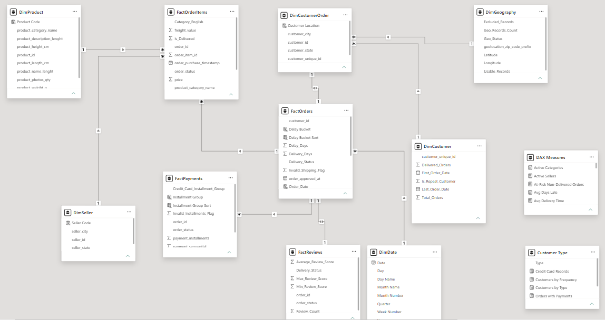

# Architecture & data lineage

## Grains and join risks

| Grain | Typical key | Main purpose | Risk if misjoined |
|---|---|---|---|
| Order | `order_id` | order status, delivery outcomes | counting repeated item/payment rows as orders |
| Order item | (`order_id`,`order_item_id`) | product value, seller attribution | sum of prices multiplied by payment lines |
| Payment record | (`order_id`,`payment_sequential`) | method mix, installments | payment sums inflated by multiple item rows |
| Review record | (`review_id`,`order_id`) in raw data | customer feedback | double-counted review/order relationships |
| Customer identity | `customer_unique_id` | repeat behavior across orders | mistaking `customer_id` for a unique person |
| Geolocation | ZIP code prefix with multiple source observations | regional mapping | joining raw coordinates directly multiplies orders |

**Illustrative join fan-out:** an order with 2 item records and 2 payment records can yield 4 rows when those facts are joined directly by `order_id`. Summing `price` over that result doubles the order's merchandise value. Instead, aggregate each fact to the appropriate grain, use distinct order IDs, or rely on separate fact tables connected through shared dimensions.

## Power BI model

The report uses a **multi-fact dimensional/hybrid model**, not a textbook pure star schema. Visible model entities include `FactOrders`, `FactOrderItems`, `FactPayments`, `FactReviews`, `DimCustomer`, `DimCustomerOrder`, `DimDate`, `DimSeller`, `DimProduct` and `DimGeography`, plus helper/measure tables. Certain 1:1 and bidirectional paths warrant careful filter-context testing; the screenshot is evidence of the implemented model, **not** proof that every relationship design choice is optimal.

### Important modeling decisions

- Preserve separate facts instead of flattening order items and payments into one huge table.
- Use `DimCustomerOrder` for the order-customer bridge and `DimCustomer` for person-level (`customer_unique_id`) analysis.
- Relate dates through the report's actual `DimDate` → `FactOrders` relationship.
- Some helper tables are disconnected intentionally for measure-driven logic; not every standalone table is a missing relationship.
- Validate every KPI under page, state, year and payment-method slicers.
